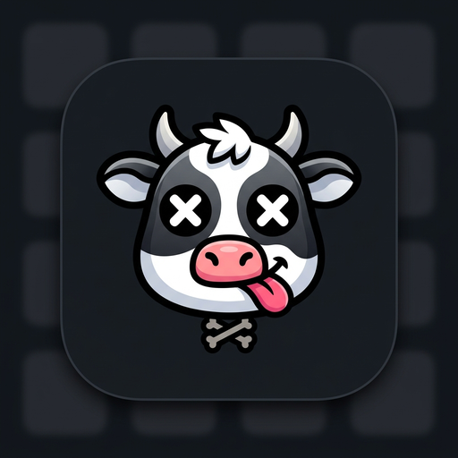

# 🐮 Deadcow — V1.0

  

  <b>La boîte à outils Android d'expérimentation radio, sans-fil et pentest matériel.</b> 
  <i>Un projet dédié à la communauté de la <b>CDC (Cult of the Dead Cow)</b> et au collectif pirate français <b>Deadcow</b>.</i>

  
  
  
  

---

## 🏴‍☠️ À propos du Projet

**Deadcow** est une suite logicielle Android puissante, portable et modulaire conçue pour les passionnés d'audit de sécurité, de radiofréquences et de bidouillage matériel. Inspirée de l'esprit du **Flipper Zero** et développée pour fonctionner sans nécessiter de droits root, elle transforme un smartphone standard en véritable couteau suisse d'interception et d'émission de protocoles.

Ce fork est dédié :
* **À l'esprit et à l'héritage de la cDc (Cult of the Dead Cow)** : pionniers du hacktivisme, de la recherche en vulnérabilités et de la libération technologique.
* **Au groupe pirate français Deadcow** : pour leurs expérimentations, leurs outils et leurs besoins d'audit de proximité sur le terrain.

---

## 🚀 Fonctionnalités & Arsenal V1

### 📡 Infrarouge (IR)
* **Base de données de télécommandes universelles** : Contrôle immédiat de téléviseurs, systèmes de climatisation, amplificateurs audio et projecteurs (intégrée depuis les dépôts Flipper-IRDB et firmware Flipper Zero).
* **IR-Storm** : Rafale automatisée de signaux de mise hors tension pour tests massifs d'environnements.
* **Brouilleur IR (IR Jammer)** : Saturation optique empêchant la réception de commandes par les équipements récepteurs.

### 📶 Bluetooth & Bluetooth Low Energy (BLE)
* **Scanner NRF Avancé** : Détection exhaustive des balises BLE, analyse de payloads publicitaires et surveillance spectrale.
* **Spam & Émulation d'appairage** : Tests de robustesse via l'émission de trames FastPair (Android), SwiftPair (Windows) et Continuity / Setup (iOS/macOS).
* **Clavier & Souris sans fil (HID)** : Émulation d'un périphérique d'entrée humain Bluetooth pour piloter un ordinateur ou déclencher des scénarios d'automatisation.
* **Deadcow Chat** : Messagerie locale directe hors-réseau (mesh P2P) fonctionnant à 100% via le protocole BLE entre utilisateurs de Deadcow.

### 💳 NFC & RFID
* **Lecture & Émulation de cartes/tags** : Lecture bas niveau, clonage et rejeu d'identifiants NFC compatibles.
* **Analyse de protocoles** : Détection des puces MIFARE, NTAG, FeliCa et ISO-DEP.

### 🌐 Réseau Local & Wi-Fi
* **Scanner LAN Ultra-rapide** : Cartographie des hôtes actifs, détection des services ouverts, identification des adresses MAC et fabricants sur le sous-réseau.
* **Outils d'audit réseau** : Simulations de résilience et tests de robustesse Wi-Fi.

### 🎮 Système de Mascotte Deadcow
* Plus vous effectuez d'actions (scans, émissions, analyses), plus votre **Deadcow** monte en niveau d'expérience (Level 1, Level 2, etc.) avec des animations personnalisées.

---

## 🌐 Documentation en ligne (GitHub Pages)

La documentation complète du projet et des plugins Python est hébergée et déployée sur **GitHub Pages** dans le dossier `/docs` :
* Guide d'installation et de démarrage rapide.
* Documentation des modules et de l'architecture.
* Guide de création de plugins Python (`.dolphyplugin` / `.deadcowplugin`).

---

## ⚙️ Build Automatique & Synchronisation CI/CD (GitHub Actions)

Ce dépôt est doté d'une intégration continue autonome :
* **Synchronisation Amont Quotidienne** : Chaque nuit à 04:00 UTC, le workflow GitHub Actions inspecte le dépôt officiel `unvoiddd/Dolphy-App`, récupère les dernières améliorations et les intègre tout en préservant l'identité et les réglages Deadcow.
* **Compilation d'APK en un clic** : Depuis l'onglet **Actions** -> `Sync Upstream & Build Deadcow APK`, vous pouvez générer l'APK **Release** ou **Debug** sans avoir besoin d'installer Android Studio sur votre machine.
* **Publication automatique des Releases** : Chaque nouveau build produit un fichier installable `Deadcow-release.apk` disponible dans l'onglet **Releases**.

---

## 📥 Téléchargement & Installation

1. Rendez-vous sur l'onglet **[Releases](../../releases)** du dépôt.
2. Téléchargez le fichier `Deadcow-release.apk`.
3. Sur votre appareil Android (version 8.0 ou supérieure requise), ouvrez le fichier et autorisez l'installation d'applications tierces.
4. Lancez **Deadcow** — l'application démarre directement en **Français** !

---

## 📜 Licence & Mentions Légales

* Distribué sous licence **GNU General Public License v3.0 (GPLv3)**.
* Développé à des fins éducatives, de recherche et d'audit défensif d'équipements autorisés.
* Remerciements et crédits aux développeurs du projet Flipper Zero et du projet source Dolphy.
